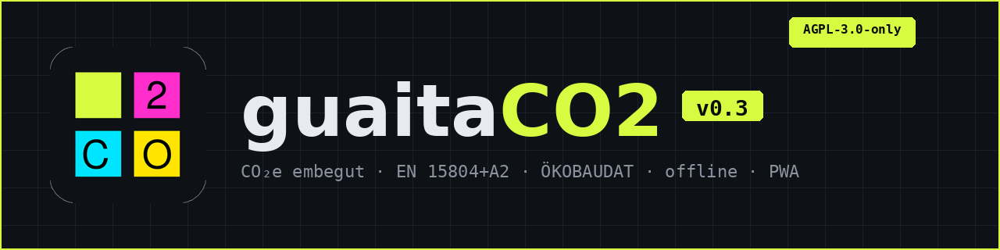

<!-- SPDX-License-Identifier: AGPL-3.0-only · Copyright (c) 2026 SBS BiM Consulting, Jordi Subirós -->
<p align="center"></p>

<p align="center">


</p>

<p align="center"><b>🇨🇦 <a href="#català">Català</a></b> · <b>🇬🇧 <a href="#english">English</a></b></p>

---

## Català

**guaitaCO2** és una eina pedagògica i independent per comparar materials i solucions constructives pel seu **CO₂e embegut** (EN 15804+A2), amb dades d'[ÖKOBAUDAT](https://www.oekobaudat.de/en/service/downloads.html). Es tria per criteri ambiental, no només per cost. És un **sol fitxer HTML**: tot passa al teu navegador, sense servidor ni comptes. Forma part de la suite **Guaita Apps**.

### Instal·la-la com a aplicació (PWA)

**PWA** vol dir *aplicació web progressiva*: instal·la guaitaCO2 a l'ordinador o al mòbil i s'obre en finestra pròpia, funciona sense connexió i es refresca quan hi ha una versió nova.

- **Chrome / Edge:** icona d'instal·lar a la barra d'adreces, o menú ⋮ / ··· → «Instal·la guaitaCO2».
- **Android:** menú del navegador → «Afegeix a la pantalla d'inici».
- Cal servir-la per HTTPS (p. ex. GitHub Pages). En obrir el fitxer en local (`file://`) funciona com a pàgina normal, però no s'instal·la.

### Funcions

| | |
|---|---|
| 🧮 **Mòduls del cicle de vida** | Resultats per fase: A1–A3, A4, A5, B1–B7, C1–C4 i D (fora dels límits), amb la dada no declarada diferenciada del zero |
| 🏗 **Obra i elements** | Quantitat, unitat i conversió per element; agrupació per capítols; cost i CO₂e per element |
| 🧱 **Solucions per capes** | Murs, forjats i cobertes com a capes per m², amb vida útil i B4 calculat o del dataset |
| 🔄 **Alternatives** | Substitueix un material per un altre de la mateixa unitat i veu Δ CO₂e i Δ cost; cost de l'estalvi en €/t CO₂e |
| 📊 **Escenaris** | Escenaris comparables amb cascada, gràfics i punts calents (Pareto) |
| 🎓 **Casos didàctics** | Exemples per a estudiants, amb l'objectiu visible |
| 📚 **Biblioteca local** | Solucions reutilitzables, desades al navegador |
| 📥 **Importa i exporta** | CSV de la biblioteca ÖKOBAUDAT (importació en streaming), projecte en JSON, elements i resultats en CSV, informe imprimible |

### Fitxers

| Fitxer | Ús |
|---|---|
| `app/guaitaCO2.html` | L'aplicació (un sol fitxer, versió 0.3, interfície en català) |
| `manifest.webmanifest`, `sw.js`, `icons/` | Instal·lació com a PWA i ús sense connexió; **han d'estar a l'arrel** |
| `pageCAT/index.html`, `pageCAT/ajuda.html` | Landing i manual en català |
| `pagesENG/index.html`, `pagesENG/help.html` | Landing i manual en anglès |
| `images/` | Captures i imatges de presentació |

### Ús

1. Obre `app/guaitaCO2.html` (o la landing de [`pageCAT/index.html`](pageCAT/index.html)).
2. Descarrega el CSV d'ÖKOBAUDAT des de la [pàgina de descàrregues](https://www.oekobaudat.de/en/service/downloads.html) i importa'l (Fitxer ▸ Importa).
3. Afegeix elements o solucions, compara alternatives i escenaris, i imprimeix l'informe.

📘 **Manual complet:** [`pageCAT/ajuda.html`](pageCAT/ajuda.html)

### Desenvolupament

```
npm install
npm run build                       # src/ -> app/guaitaCO2.html
ODB_CSV=/path/OBD_2024_II.csv npm test
```

El CSV d'ÖKOBAUDAT **no** s'inclou al repositori.

### Limitacions conegudes

Eina indicativa i educativa: **no és una certificació, ni una EPD, ni un ACV d'edifici**. Només considera els materials i les solucions que introdueixes; no calcula l'edifici complet. Les dades són les que publica ÖKOBAUDAT: la seva vigència, la seva representativitat i la verificació dels resultats són responsabilitat de l'usuari. Els valors per m² de LETI i RIBA provenen de fonts secundàries i cal verificar-los amb les publicacions originals. Les dades d'ÖKOBAUDAT no es redistribueixen; les condicions de redistribució no estan confirmades.

### Contribuir

Les contribucions són benvingudes. Abans d'enviar una pull request, cal acceptar el [CLA v1.0](https://github.com/subi2/guaitaPDF/blob/main/CLA.md) (Acord de Llicència de Contribuïdor) i incloure la línia `Signed-off-by` a cada commit.

### Llicència

Programari lliure sota la [GNU Affero General Public License v3.0 (AGPL-3.0-only)](LICENSE). © 2026 Jordi Subirós · SBS BiM Consulting.

---

## English

**guaitaCO2** is an independent educational tool to compare building materials and construction solutions by their **embodied CO₂e** (EN 15804+A2), using [ÖKOBAUDAT](https://www.oekobaudat.de/en/service/downloads.html) data. It supports choosing by environmental criteria, not only by cost. It is a **single HTML file**: everything runs in your browser, with no server and no accounts. It is part of the **Guaita Apps** suite.

### Install it as an app (PWA)

**PWA** means *progressive web app*: install guaitaCO2 on your computer or phone. It opens in its own window, works offline and refreshes when a new version is available.

- **Chrome / Edge:** install icon in the address bar, or ⋮ / ··· menu → “Install guaitaCO2”.
- **Android:** browser menu → “Add to Home screen”.
- Serve it over HTTPS (e.g. GitHub Pages). Opened locally (`file://`) it works as a normal page, but cannot be installed.

### Features

| | |
|---|---|
| 🧮 **Life-cycle modules** | Results per stage: A1–A3, A4, A5, B1–B7, C1–C4 and D (beyond the system boundary), with missing data clearly distinguished from zero |
| 🏗 **Project and items** | Quantity, unit and conversion per item; grouping by chapter; cost and CO₂e per item |
| 🧱 **Layered solutions** | Walls, slabs and roofs as layers per m², with service life and B4 calculated or taken from the dataset |
| 🔄 **Alternatives** | Replace a material with another of the same unit and see Δ CO₂e and Δ cost; cost of saving in €/t CO₂e |
| 📊 **Scenarios** | Comparable scenarios with cascade, charts and hot spots (Pareto) |
| 🎓 **Teaching cases** | Examples for students, with the objective visible |
| 📚 **Local library** | Reusable solutions saved in the browser |
| 📥 **Import and export** | ÖKOBAUDAT CSV library (streamed import), project as JSON, items and results as CSV, printable report |

### Files

| File | Use |
|---|---|
| `app/guaitaCO2.html` | The application (single file, version 0.3, Catalan interface) |
| `manifest.webmanifest`, `sw.js`, `icons/` | PWA install and offline use; **must be at the root** |
| `pageCAT/index.html`, `pageCAT/ajuda.html` | Catalan landing and manual |
| `pagesENG/index.html`, `pagesENG/help.html` | English landing and manual |
| `images/` | Screenshots and presentation images |

### Usage

1. Open `app/guaitaCO2.html` (or the landing page [`pagesENG/index.html`](pagesENG/index.html)).
2. Download the ÖKOBAUDAT CSV from the [downloads page](https://www.oekobaudat.de/en/service/downloads.html) and import it (File ▸ Import).
3. Add items or solutions, compare alternatives and scenarios, and print the report.

📘 **Full guide:** [`pagesENG/help.html`](pagesENG/help.html)

### Development

```
npm install
npm run build                       # src/ -> app/guaitaCO2.html
ODB_CSV=/path/OBD_2024_II.csv npm test
```

The ÖKOBAUDAT CSV is **not** included in this repository.

### Known limitations

An indicative, educational tool: **not a certification, not an EPD and not a building LCA**. It only considers the materials and solutions you enter; it does not calculate the whole building. The data are those published by ÖKOBAUDAT: their validity, representativeness and the verification of results are the user's responsibility. LETI and RIBA per-m² values come from secondary sources and must be checked against the original publications. ÖKOBAUDAT data are not redistributed; redistribution terms are unconfirmed.

### Contributing

Contributions are welcome. Before opening a pull request, please accept the [CLA v1.0](https://github.com/subi2/guaitaPDF/blob/main/CLA.md) (Contributor License Agreement) and add a `Signed-off-by` line to each commit.

### Licence

Free software under the [GNU Affero General Public License v3.0 (AGPL-3.0-only)](LICENSE). © 2026 Jordi Subirós · SBS BiM Consulting.

---

> Guaita Apps es distribueix «tal com és», sense cap garantia. / Guaita Apps is distributed “as is”, without any warranty.
